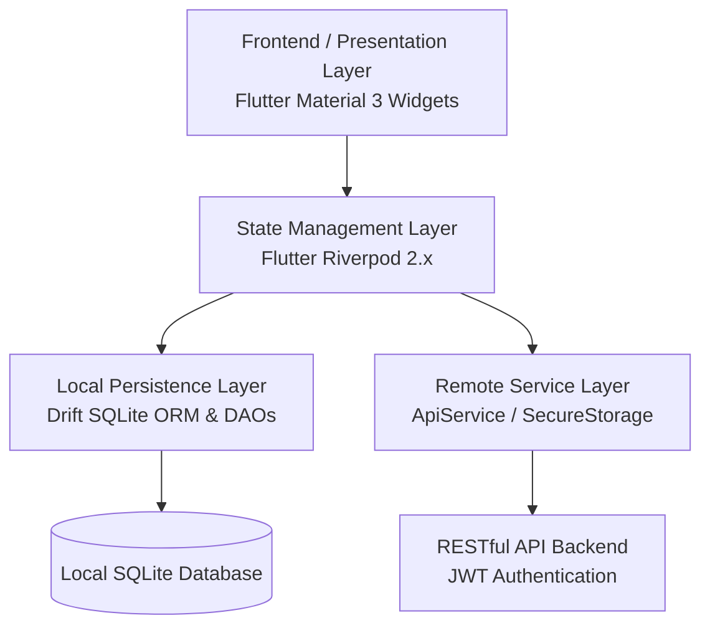

# 💊 Pharmace — Intelligent Pharmacy Management & POS System

<p align="center">
  
</p>

<p align="center">
  <b>A comprehensive, offline-first cross-platform Pharmacy Store Management, POS, and Inventory System built with Flutter, Riverpod, Drift (SQLite), and RESTful Backend APIs.</b>
</p>

<p align="center">
  
  
  
  
  
  
</p>

---

## 📋 Table of Contents
- [Overview](#-overview)
- [Key Features](#-key-features)
- [Application Modules & Screens](#-application-modules--screens)
- [Technical Architecture](#-technical-architecture)
- [Database Schema (Drift / SQLite)](#-database-schema-drift--sqlite)
- [Technology Stack & Packages](#-technology-stack--packages)
- [Project Directory Structure](#-project-directory-structure)
- [Getting Started & Installation](#-getting-started--installation)
- [API Configuration & Backend Connectivity](#-api-configuration--backend-connectivity)
- [Design System & Theming](#-design-system--theming)
- [Contributing & License](#-contributing--license)

---

## 🌟 Overview

**Pharmace** is designed for modern retail pharmacies, hospital dispensaries, and multi-chain medical stores. It bridges day-to-day point-of-sale billing with enterprise-grade batch inventory tracking, staff management, drug compliance monitoring, and automated near-expiry alerts.

Built with an **Offline-First** mindset using **Drift ORM (SQLite)** and secure background sync, pharmacies can conduct rapid billing and manage catalog inventory even when internet connectivity is intermittent.

---

## 🚀 Key Features

### 🏬 Multi-Store & Chain Management
- Switch between multiple shop branches seamlessly via the dashboard branch selector.
- Independent license numbers (Form 20/21), GSTIN, addresses, and geo-location coordinates per branch.
- Instant Store Status toggle (**Open / Closed**) and Delivery Service availability control.

### 📦 Smart Batch Inventory Management
- Track medicines across categories, dosage forms (tablets, capsules, syrups, injections, drops, ointments), and manufacturers.
- Strict **Batch Number** and **Expiry Date** monitoring.
- Dynamic stock alerts: **Critical Low Stock** (`< threshold`) and **Near-Expiry Warning** flags.
- Comprehensive pricing: MRP, Purchase Price, Selling Rate, GST brackets (5%, 12%, 18%, 28%), and Rack/Shelf tracking.

### 🧾 Fast Point of Sale (POS) & Invoicing
- Generate professional tax invoices (`INV-XXXX`) in seconds.
- Support for **Walk-in** and **Registered/Credit** customers with phone lookup.
- Flexible payment methods: **Cash, UPI / Dynamic QR, Credit/Debit Card, Net Banking**.
- Printable thermal receipts and digital PDF sharing via system share (`printing`, `pdf`, `share_plus`).

### 👥 Staff & Role-Based Attendance
- Role division: **Store Manager, Registered Pharmacist, Cashier, General Staff**.
- Staff attendance tracking with dedicated **Employee QR Codes**.
- Emergency contact information, salary agreements, document tracking, and duty status.

### 🔔 Proactive Notification Center
- Real-time categorized alerts:
  - ⚠️ **Low Stock Warnings**: Immediate reorder prompts when critical medicines drop below safe levels.
  - ⏳ **Batch Expiry Alerts**: 30-day and 15-day advance warnings to eliminate dead inventory.
  - 💰 **Sales & Cash Milestones**: Shift closing totals and high-value customer transactions.
  - 🧑‍⚕️ **Staff Duty Updates**: Clock-in and shift assignments.
  - 🛡️ **System & Compliance**: Retail Drug License renewal reminders and database cloud backup receipts.
- Interactive filter chips (**All, Unread, Low Stock, Expiry, Sales, Staff, System**), quick search, mark-all-read, swipe-to-delete with undo, and custom alert preferences.

### 📊 Business Pulse & Analytics
- Live dashboard metrics: Daily revenue, transaction counts, gross profit estimations.
- Interactive sales overview charts powered by `fl_chart`.
- Top-selling medicines and periodic comparative reporting (Weekly, Monthly, Quarterly).

---

## 📱 Application Modules & Screens

```
lib/Frontend/
├── main.dart                                # Navigation scaffold & responsive wrapper
├── screens/
│   ├── auth_screens/
│   │   ├── splash_screen.dart               # Token check & auto-route logic
│   │   ├── login_screen.dart                # Owner authentication with JWT
│   │   ├── signup_screen.dart               # New pharmacy business owner registration
│   │   └── add_shop_screen.dart             # Register a pharmacy branch with GPS/GSTIN
│   ├── fragment_screen/
│   │   ├── home_screen.dart                 # Dashboard, pulse metrics, charts, quick actions
│   │   ├── inventory_screen.dart            # Stock catalog, search, category filter
│   │   ├── sales_screen.dart                # Invoice history, receipt viewing, date filter
│   │   ├── employees_screen.dart            # Staff directory, duty roster, attendance
│   │   └── profile_screen.dart              # Branch settings, edit store, compliance
│   └── other_screen/
│       ├── notification_screen.dart         # Categorized alerts, search, swipe-dismiss, preferences
│       ├── new_bill_screen.dart             # Fast POS cart, medicine picker, payment modal
│       ├── bill_details_screen.dart         # Detailed invoice, thermal print & PDF share
│       ├── add_medicine_screen.dart         # New drug entry, batch code, expiry, GST, rack
│       ├── medicine_details_screen.dart     # Stock adjustment, batch details, pricing breakdown
│       ├── add_employees_screen.dart        # Register new staff member, role & salary
│       ├── employee_details_screen.dart     # Full staff profile, emergency info, attendance
│       ├── employee_qr_screen.dart          # QR badge generation for fast scanner check-in
│       └── reports_screen.dart              # Profit/Loss, top drugs, inventory health export
└── Profile/screens/
    └── acount_and_settings.dart             # Owner credentials, theme, notification preferences
```

---

## 🏗️ Technical Architecture

Pharmace employs a modular **Layered Architecture**:



1. **Presentation Layer (`lib/Frontend`)**:
   - Modern Material 3 UI with cohesive typography, micro-interactions, responsive sizing (`ResponsiveUtils`), and full light/dark theme support.
2. **State Management (`lib/Provider`)**:
   - Powered by `flutter_riverpod`.
   - Providers: `shopProvider`, `ownerProvider`, `inventoryProvider`, `salesProvider`, `employeeProvider`, `recentSalesProvider`, `databaseProvider`.
3. **Local Database & Cache (`lib/LocalDB`)**:
   - Built on **Drift** (formerly Moor).
   - Reactive DAOs stream queries automatically when records change.
4. **Backend & Security (`lib/Backend`)**:
   - REST client handling authentication, store registration, inventory sync, and bill uploads.
   - JWT tokens stored in hardware-backed secure storage via `flutter_secure_storage`.

---

## 🗄️ Database Schema (Drift / SQLite)

The offline database is defined in `lib/LocalDB/database.dart` with dedicated Data Access Objects (DAOs):

| Table | Description | Key Fields |
|---|---|---|
| **`ShopTable`** | Pharmacy branches owned by the user | `id`, `shopName`, `shopCode`, `ownerId`, `address`, `city`, `state`, `pincode`, `gstNumber`, `licenseNumber`, `isOpen`, `verifyStatus`, `latitude`, `longitude` |
| **`OwnerAuthTable`** | Authenticated business owner record | `id`, `name`, `email`, `phone`, `role`, `createdAt` |
| **`InventoryMedicineTable`** | Medicines and health products in stock | `id`, `medicineName`, `category`, `manufacturer`, `batchNumber`, `expiryDate`, `quantity`, `minThreshold`, `purchasePrice`, `sellingPrice`, `mrp`, `gstPercentage`, `shelfLocation` |
| **`BillTable`** | Customer invoices and POS transactions | `id`, `billNumber`, `shopId`, `customerName`, `customerPhone`, `paymentType`, `subTotal`, `discount`, `taxAmount`, `grandTotal`, `createdAt` |
| **`BillMedicineTable`** | Line items associated with each bill | `id`, `billId`, `medicineId`, `medicineName`, `quantity`, `unitPrice`, `totalPrice` |

---

## 🛠️ Technology Stack & Packages

### Core Dependencies (`pubspec.yaml`)
| Package | Version | Purpose |
|---|---|---|
| **`flutter`** | SDK | Cross-platform UI toolkit |
| **`flutter_riverpod`** | `^2.6.1` | Compile-safe, reactive state management |
| **`drift` & `drift_flutter`** | `^2.35.0` | High-performance type-safe SQLite database |
| **`flutter_secure_storage`** | `^11.0.0` | Encrypted keychain/keystore token storage |
| **`http`** | `^1.6.0` | REST API communication |
| **`jwt_decoder`** | `^2.0.1` | Client-side JWT inspection & expiration check |
| **`fl_chart`** | `^1.2.0` | Smooth, animated analytics charts |
| **`printing` & `pdf`** | `^5.15.0` | Thermal receipt formatting, invoice generation & printing |
| **`share_plus`** | `^13.3.0` | Share invoices, receipts, and reports via external apps |
| **`qr_flutter`** | `^4.1.0` | Dynamic QR code generation for staff check-in & UPI |
| **`geolocator` & `geocoding`** | `^14.0.3` | GPS store location & address resolution |
| **`window_manager`** | `^0.5.2` | Desktop window control (Windows, Linux, macOS) |
| **`flutter_svg`** | `^2.3.0` | Scalable vector graphic support |

---

## 📂 Project Directory Structure

```text
pharmace/
├── assets/
│   ├── fonts/                       # Custom typography
│   ├── icons/                       # Brand icons and SVGs
│   └── images/                      # Placeholder illustrations
├── lib/
│   ├── Backend/
│   │   ├── api_service.dart         # HTTP service & REST endpoints
│   │   ├── auth/                    # Secure token helpers
│   │   └── model/                   # Request/Response DTOs & JSON serializations
│   ├── Frontend/
│   │   ├── main.dart                # Main App entrypoint & routing state
│   │   ├── responsive_utils.dart    # Device breakpoints & adaptive sizing
│   │   ├── theme/
│   │   │   ├── app_colors.dart      # Curated brand color tokens
│   │   │   ├── app_theme.dart       # Light and Dark Material 3 Theme data
│   │   │   └── app_theme_extension.dart # Semantic ThemeExtension (success, warning, etc.)
│   │   ├── Home/                    # Dashboard widgets, metric cards & chart components
│   │   ├── Inventory/               # Inventory sub-components & lists
│   │   ├── Sales/                   # POS sub-components & bill item cards
│   │   ├── Employees/               # Staff card components & filters
│   │   ├── Profile/                 # Shop settings & account screens
│   │   ├── Widget/                  # Reusable form fields, dialogs & buttons
│   │   └── screens/                 # Core screen destinations
│   ├── LocalDB/
│   │   ├── database.dart            # Drift database class & connection
│   │   ├── DAO/                     # Data Access Objects (Shop, Bill, Inventory, Owner)
│   │   └── table/                   # Drift table schemas
│   └── Provider/                    # Riverpod state providers
├── pubspec.yaml                     # Dependencies and assets configuration
└── README.md                        # Project documentation
```

---

## ⚙️ Getting Started & Installation

### Prerequisites
- **Flutter SDK**: `^3.12.0` or higher
- **Dart SDK**: `^3.12.0`
- **Android Studio / VS Code** with Flutter & Dart extensions
- (For Windows/Desktop development) **Visual Studio 2022** with C++ desktop components

### 1. Clone the Repository
```bash
git clone https://github.com/your-username/pharmace.git
cd pharmace
```

### 2. Install Dependencies
```bash
flutter pub get
```

### 3. Generate Database & Model Code
Drift uses `build_runner` for generating type-safe tables and queries:
```bash
dart run build_runner build --delete-conflicting-outputs
```

### 4. Run the Application
- **Mobile (Android/iOS)**:
  ```bash
  flutter run
  ```
- **Desktop (Windows)**:
  ```bash
  flutter run -d windows
  ```
- **Web**:
  ```bash
  flutter run -d chrome
  ```

---

## 🌐 API Configuration & Backend Connectivity

The API client is located in [`lib/Backend/api_service.dart`](file:///c:/Users/sm803/AndroidStudioProjects/Flutter/pharmace/lib/Backend/api_service.dart):

```dart
static String get baseUrl =>
    'http://${Platform.isAndroid ? '10.0.2.2' : 'localhost'}:8080/v1';
```

- **Android Emulator**: Uses `10.0.2.2` (or your local network IP) to connect to a local server.
- **Physical Device**: Replace with your local machine's LAN IP address (e.g. `192.168.1.X:8080`).
- **Desktop / Web**: Connects to `localhost:8080`.

---

## 🎨 Design System & Theming

Pharmace includes a custom healthcare color palette that complies with Material 3 guidelines and supports **Light** and **Dark** themes:

| Color Token | Hex Code | Purpose |
|---|---|---|
| **Primary** | `#0E6B58` | Deep Medical Emerald (Brand Accent) |
| **Primary Light** | `#2A8C78` | Active chips, hover states, badges |
| **Primary Container** | `#E5F1EE` | Subtle card tints & light icons |
| **Success** | `#1E8E5A` | Paid bills, in-stock medicines, verified status |
| **Warning / Gold** | `#B4700F` / `#A9791F` | Near-expiry batches, low stock warnings |
| **Danger / Error** | `#BE3B3B` | Out of stock, expired batches, deleted records |

Theme switching automatically reacts to the system brightness or can be toggled manually via `ThemeMode`.

---

## 🤝 Contributing & Guidelines

1. Fork the Project.
2. Create your Feature Branch (`git checkout -b feature/AmazingFeature`).
3. Commit your Changes (`git commit -m 'Add some AmazingFeature'`).
4. Push to the Branch (`git push origin feature/AmazingFeature`).
5. Open a Pull Request.

---

## 📄 License
This project is proprietary and intended for pharmacy retail operations. All rights reserved.
