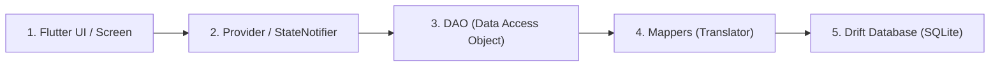

# Drift for Beginners: Step-by-Step Guide

This guide explains how **Drift (Local SQLite Database)** works in the **Pharmace** app in simple, beginner-friendly terms.

---

## 🧠 The Big Picture: How Drift Works

Think of Drift as a **safe, type-checked bridge between Flutter and SQLite**:



In your project, every database task follows **5 simple pieces**:
1. **Table (`table/`)**: The blueprint defining columns (e.g., `id`, `name`, `price`).
2. **Database (`database.dart`)**: The central manager opening the SQLite file.
3. **Code Generator (`build_runner`)**: Creates `database.g.dart` automatically.
4. **Mapper (`Maper/`)**: Translates your UI models (like `MedicineModel`) into Drift format.
5. **DAO (`DAO/`)**: The helper functions you call to Insert, Read, Update, and Delete.

---

## 🚀 Step-by-Step: Everyday Workflows

---

### 🔹 Workflow 1: How to Save Data to the Database

#### Step 1: Create or get your UI model
```dart
final newMedicine = MedicineModel(
  id: 'MED123',
  medicineNmae: 'Paracetamol 500mg',
  price: 15.0,
  // ... other fields
);
```

#### Step 2: Use the Mapper to convert it to a Companion
Drift uses a special class called a **Companion** to insert or update rows:
```dart
// toCompanion() comes from medicine_model_maper.dart
final companion = newMedicine.toCompanion();
```

#### Step 3: Call the DAO method
```dart
await db.inventoryMedicineDao.insertMedicine(newMedicine);
```
*Done! Drift takes care of the SQL query behind the scenes.*

---

### 🔹 Workflow 2: How to Read Data from the Database

```dart
// 1. Ask the DAO for the data
List<MedicineTableData> rows = await db.inventoryMedicineDao.getAllMedicines();

// 2. Map the database rows back into your UI model (if needed) or use directly
for (final row in rows) {
  print('Medicine: ${row.medicineNmae}, Price: ₹${row.price}');
}
```

---

### 🔹 Workflow 3: How to Update Data

#### Option A: Update an entire item (like a Medicine)
```dart
await db.inventoryMedicineDao.updateMedicine('MED123', updatedMedicine);
```

#### Option B: Update a Bill with all its medicines
```dart
// Updates the bill header AND replaces its medicine items atomically
await db.billDao.updateBill(myUpdatedBill);
```

---

### 🔹 Workflow 4: How to Delete Data

```dart
// Deleting by ID
await db.inventoryMedicineDao.deleteMedicine('MED123');

// Deleting an invoice (all associated medicines delete automatically!)
await db.billDao.deleteBill('INV-001');
```

---

## 🛠️ Step-by-Step: Adding a New Table (From Scratch)

Whenever you need to add a brand new table (e.g. `CustomerTable`), follow these **4 easy steps**:

### Step 1: Create the Table file
Create a file under `lib/LocalDB/table/customer/customer_table.dart`:

```dart
import 'package:drift/drift.dart';

class CustomerTable extends Table {
  TextColumn get id => text()();
  TextColumn get name => text()();
  TextColumn get phone => text()();

  @override
  Set<Column> get primaryKey => {id};
}
```

### Step 2: Register it in `database.dart`
Open `lib/LocalDB/database.dart`:
1. Import your new table.
2. Add it to `tables: [...]`:
```dart
@DriftDatabase(
  tables: [MedicineTable, BillTable, BillMedicineTable, CustomerTable], // <-- Added here
  daos: [InventoryMedicineDao, BillDao],
)
```
3. Increment the `schemaVersion`:
```dart
@override
int get schemaVersion => 3; // increment by 1
```

### Step 3: Run the Fast Code Generator
Open your terminal and run:
```bash
dart run build_runner build
```
*(Takes only ~10 seconds because `build.yaml` is already set up!)*

### Step 4: Create a DAO for your queries
Create `lib/LocalDB/DAO/customer_dao/customer_dao.dart`:
```dart
import 'package:drift/drift.dart';
import 'package:pharmace/LocalDB/database.dart';
import 'package:pharmace/LocalDB/table/customer/customer_table.dart';

part 'customer_dao.g.dart';

@DriftAccessor(tables: [CustomerTable])
class CustomerDao extends DatabaseAccessor<AppDatabase> with _$CustomerDaoMixin {
  CustomerDao(super.db);

  Future<List<CustomerTableData>> getAllCustomers() => select(customerTable).get();

  Future<void> insertCustomer(CustomerTableCompanion customer) =>
      into(customerTable).insert(customer);
}
```
Run `dart run build_runner build` one more time to generate `customer_dao.g.dart`.

---

## 🔌 Step-by-Step: How to Use the Database in Riverpod / UI

### Step 1: Create a Database Provider
In your provider folder (e.g., `lib/Provider/database_provider.dart`):

```dart
import 'package:flutter_riverpod/flutter_riverpod.dart';
import 'package:pharmace/LocalDB/database.dart';

// Single instance of database across the entire app
final databaseProvider = Provider<AppDatabase>((ref) {
  final db = AppDatabase();
  ref.onDispose(() => db.close());
  return db;
});
```

### Step 2: Access in a Widget or Notifier
In any `ConsumerWidget` or `ConsumerStatefulWidget`:

```dart
class MedicineListScreen extends ConsumerWidget {
  const MedicineListScreen({super.key});

  @override
  Widget build(BuildContext context, WidgetRef ref) {
    final db = ref.watch(databaseProvider);

    return FutureBuilder<List<MedicineTableData>>(
      future: db.inventoryMedicineDao.getAllMedicines(),
      builder: (context, snapshot) {
        if (snapshot.connectionState == ConnectionState.waiting) {
          return const Center(child: CircularProgressIndicator());
        }

        final medicines = snapshot.data ?? [];
        if (medicines.isEmpty) {
          return const Center(child: Text('No medicines found'));
        }

        return ListView.builder(
          itemCount: medicines.length,
          itemBuilder: (context, index) {
            final med = medicines[index];
            return ListTile(
              title: Text(med.medicineNmae),
              subtitle: Text('Stock: ${med.stockValue} | MRP: ₹${med.mrp}'),
            );
          },
        );
      },
    );
  }
}
```

---

## ⚡ Golden Rules to Remember

| Rule | What to Do |
| :--- | :--- |
| **Never edit `.g.dart` files** | Drift auto-generates them. Any edits will be wiped out next build. |
| **Always use Transactions for Bills** | When saving a bill + medicines, wrap with `transaction(...)`. If one fails, everything rolls back safely. |
| **Use `batch` for multiple rows** | `batch((b) => b.insertAll(...))` is up to 50x faster than inserting in a `for` loop. |
| **Fast code builds** | Always run `dart run build_runner build`. Do NOT worry about slow builds anymore because `build.yaml` speeds it up! |
